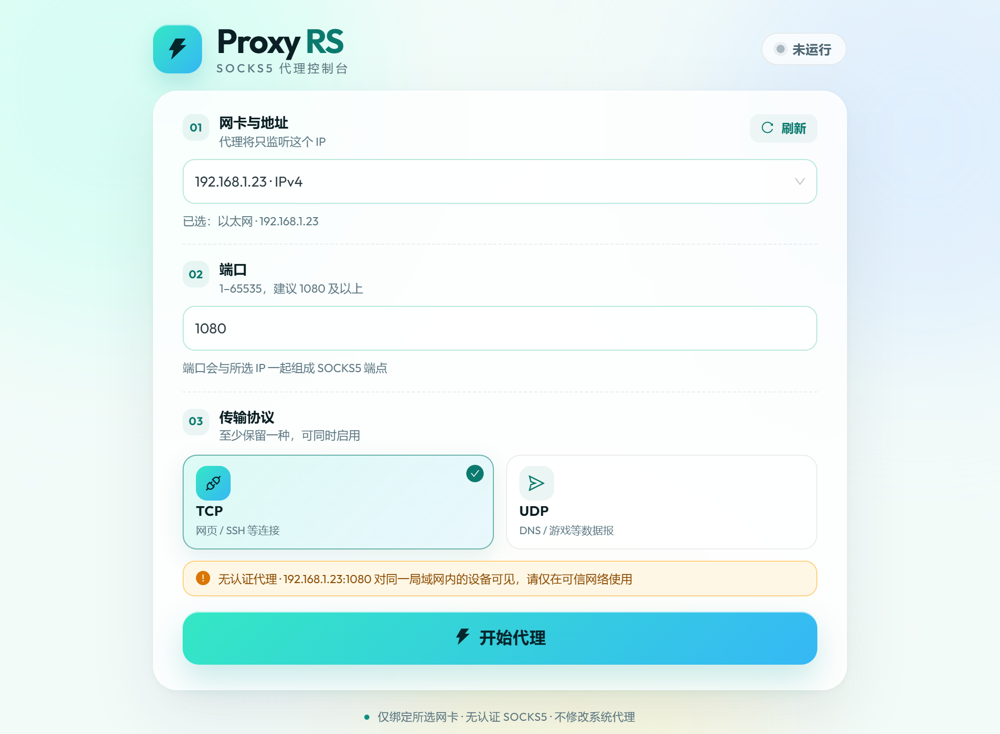
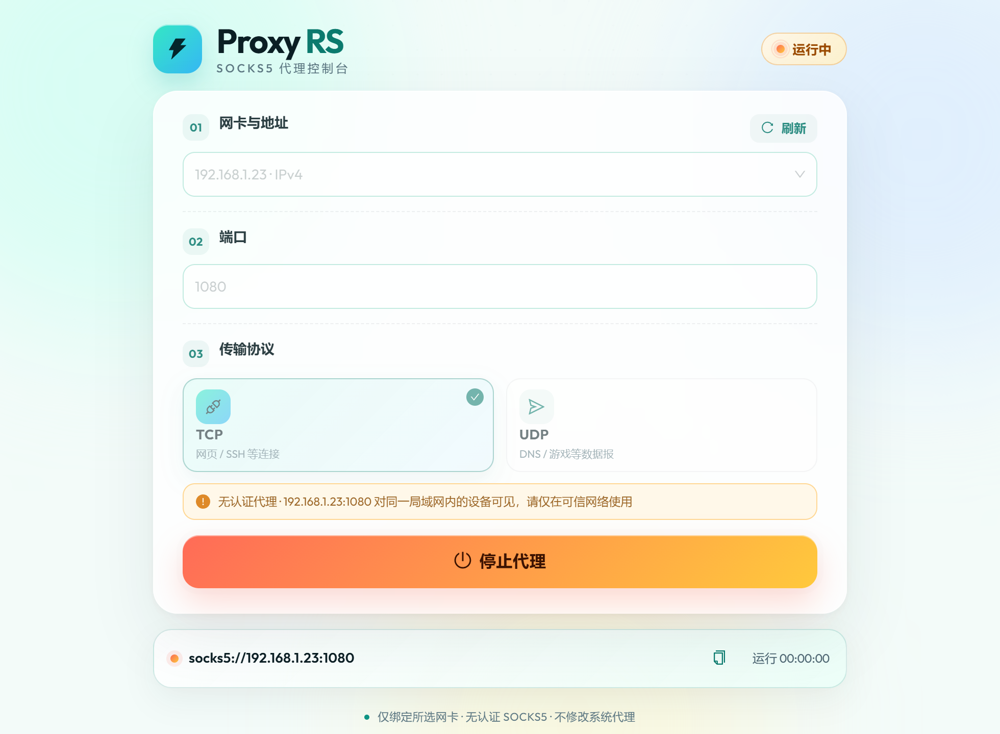
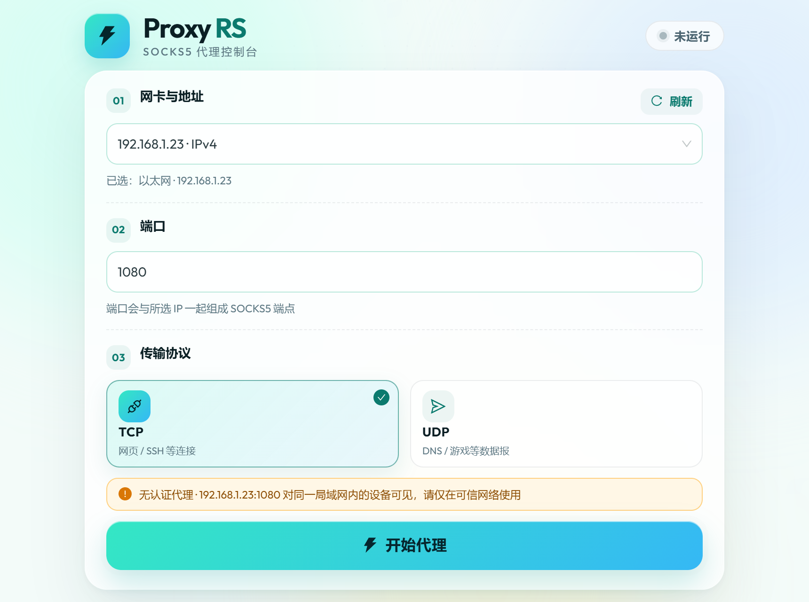

# Proxy RS

[](https://github.com/chenzhi-9019/proxy-rs/actions/workflows/release.yml)
[](https://github.com/chenzhi-9019/proxy-rs/releases/latest)

年轻、轻量的桌面 SOCKS5 代理工具。按网卡选择监听 IP，填写端口并勾选 TCP / UDP，一键启动无认证代理。



| 运行中（红黄激活态） | 最小窗口 860×640 |
| --- | --- |
|  |  |

## 下载安装

最新 Windows 安装包见 [GitHub Releases](https://github.com/chenzhi-9019/proxy-rs/releases/latest)。

安装时可以选择：

- **仅为我安装**：安装到当前用户目录，不需要管理员权限。
- **为所有用户安装**：安装到系统目录，需要管理员权限，同机所有用户可用。
- **自定义安装目录**：安装向导提供目录选择页。

安装包未做代码签名，Windows SmartScreen 可能提示；选择“更多信息 → 仍要运行”即可。

## 功能

- 枚举本机所有网卡地址，按“网卡 · IP”分组选择，支持搜索与刷新。
- 支持通用地址 `0.0.0.0`（“所有网卡”）：本机客户端仍用 `127.0.0.1`，其他设备用本机局域网 IP。
- 端口 1–65535 校验，前端就地提示、后端二次校验。
- TCP 与 UDP 可多选，至少保留一种。
- 无认证 SOCKS5：TCP `CONNECT`、UDP `UDP ASSOCIATE`；未勾选的协议返回 `Command not supported`。
- 开始按钮蓝绿渐变，运行中切换为红黄“停止代理”；展示端点、运行时长与错误原因。
- 只绑定所选网卡 IP；选择非回环地址时展示局域网暴露警告。

## 技术栈

| 层 | 技术 |
| --- | --- |
| 桌面壳 | Tauri 2 |
| 前端 | Vue 3 + TypeScript + Vite + Ant Design Vue 4 |
| 代理内核 | Rust + Tokio，自研 RFC 1928 无认证子集 |
| 网卡枚举 | `if-addrs` |

## 环境要求

- Node.js 20.19+（推荐 24）
- pnpm 10+
- Rust 1.90+（stable）
- Windows 10/11：WebView2 Runtime 与 MSVC 构建工具
- macOS / Linux 可编译，未做发布级验证

## 开始使用

```bash
pnpm install
pnpm tauri dev
```

生产构建：

```bash
pnpm tauri build
```

安装包输出在 `src-tauri/target/release/bundle/nsis/`（NSIS `.exe` 安装程序）。

前端单独调试（不启动 Rust 后端，界面使用内存 mock）：

```bash
pnpm dev
```

测试与静态检查：

```bash
pnpm test                 # 前端纯函数单测
pnpm build                # vue-tsc + vite build
cargo test                # 在 src-tauri 目录执行
cargo clippy -- -D warnings
```

发布：推送 `v*` 标签会触发 [release workflow](.github/workflows/release.yml)，在 Windows runner 上构建 NSIS 安装包并创建 GitHub Release。

## 使用说明

1. 在“01 网卡与地址”选择要监听的网卡 IP。默认选第一个非回环 IPv4。
2. 在“02 端口”填写 1–65535，建议使用 1080。
3. 在“03 传输协议”勾选 TCP 或 UDP，至少一项。
4. 点击“开始代理”。运行后按需复制 `socks5://IP:端口` 给客户端使用。
5. 再次点击红黄色“停止代理”释放端口。

## 传输协议怎么选

- **仅 TCP**：支持 SOCKS5 `CONNECT`，适合网页、SSH、Git 等连接型流量。客户端发 `UDP ASSOCIATE` 会收到 `0x07 Command not supported`。
- **TCP + UDP**：额外支持 `UDP ASSOCIATE`，每个关联绑定一个 UDP 中继端口，适合 DNS、游戏、QUIC 等数据报流量；中继只接受来自控制连接对端的源 IP。
- **仅 UDP**：只接受 `UDP ASSOCIATE`，`CONNECT` 返回 `0x07`。适合只做数据报转发的场景。

客户端配置：

```bash
# 让客户端把域名交给代理解析（推荐）
curl --socks5-hostname 127.0.0.1:1080 https://example.com

# 由客户端本地解析域名
curl --socks5 127.0.0.1:1080 https://example.com

# 验证本地目标
curl --socks5-hostname 127.0.0.1:1080 http://127.0.0.1:8000/
```

浏览器 / 系统代理中填写主机 `127.0.0.1`、端口 `1080`，类型选择 SOCKS5 即可。

### Xshell / SSH 客户端

- 代理类型：**SOCKS5**
- 代理主机：
  - 应用中选择 `0.0.0.0 · 所有网卡` 或回环地址时，填 `127.0.0.1`
  - 选择具体网卡 IP 时，填该 IP（例如 `192.168.1.89`）
- 代理端口：应用里填写的端口，例如 `1080`
- 用户名/密码：留空
- **SSH 主机**仍填目标服务器地址，不要把代理地址填到 SSH 主机一栏

## 安全提示

- 本工具**不提供用户名/密码认证**。绑定到非回环地址或 `0.0.0.0` 时，同一局域网内设备可以直接使用该代理。
- 选择 `0.0.0.0` 会监听所有 IPv4 网卡，请务必确认当前网络可信，并在不需要时立即停止。
- 请只在可信网络使用，并在不需要时立即停止。
- 首次监听非回环地址时，Windows 防火墙可能弹出提示；若要从其他设备访问，需要允许“专用网络”，否则外部连接会超时。
- 应用不会修改系统代理设置，也不会写入注册表或自动开放端口。
- IPv6 链路本地地址（`fe80::/10`）不会出现在下拉框；单播 IPv4 / IPv6 与回环地址均可用。

## 目录结构

```text
src/                 Vue 3 前端（组件、组合式函数、纯函数、样式）
src-tauri/src/       Rust 后端
  model.rs           配置/状态类型与校验
  interfaces.rs      网卡枚举、过滤与排序
  proxy/             SOCKS5 协议、TCP/UDP 转发、生命周期
  commands.rs        Tauri IPC 命令
src-tauri/tauri.conf.json
openspec/            需求、规格、设计与任务（OpenSpec）
```

## 已知限制

- 不做认证、ACL、按域名分流、流量统计与系统代理接管。
- 不支持 IPv6 链路本地地址（缺少 scope id，无法可靠绑定）。
- UDP 中继使用单关联套接字，超高并发数据报场景的吞吐有限。
- 当前以 Windows 为主要目标平台。
